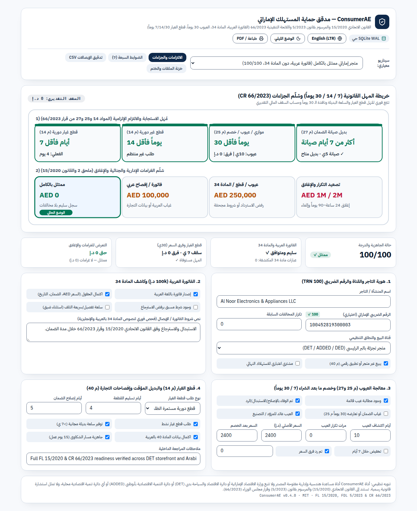
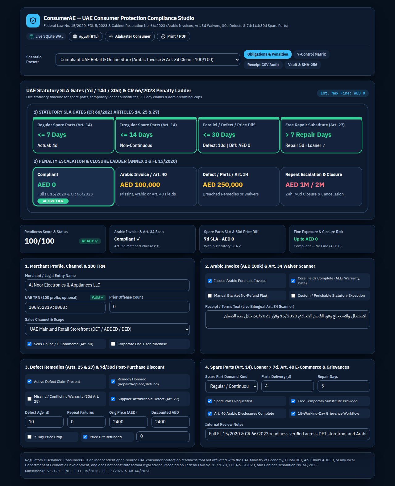
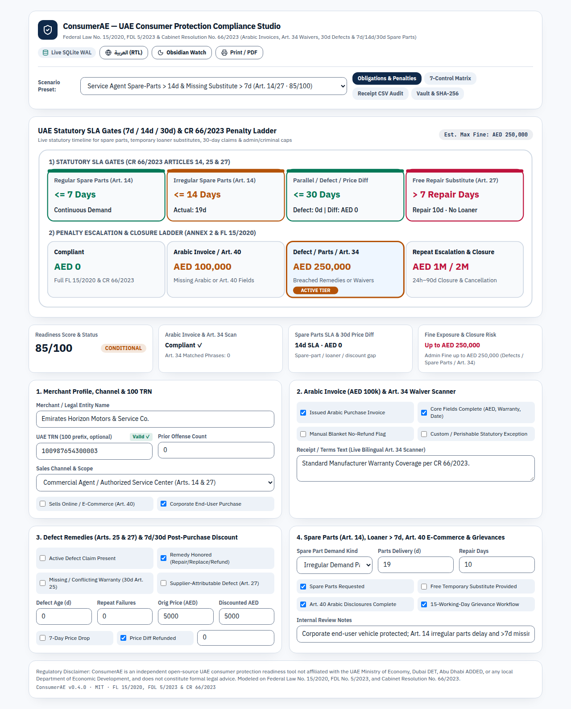
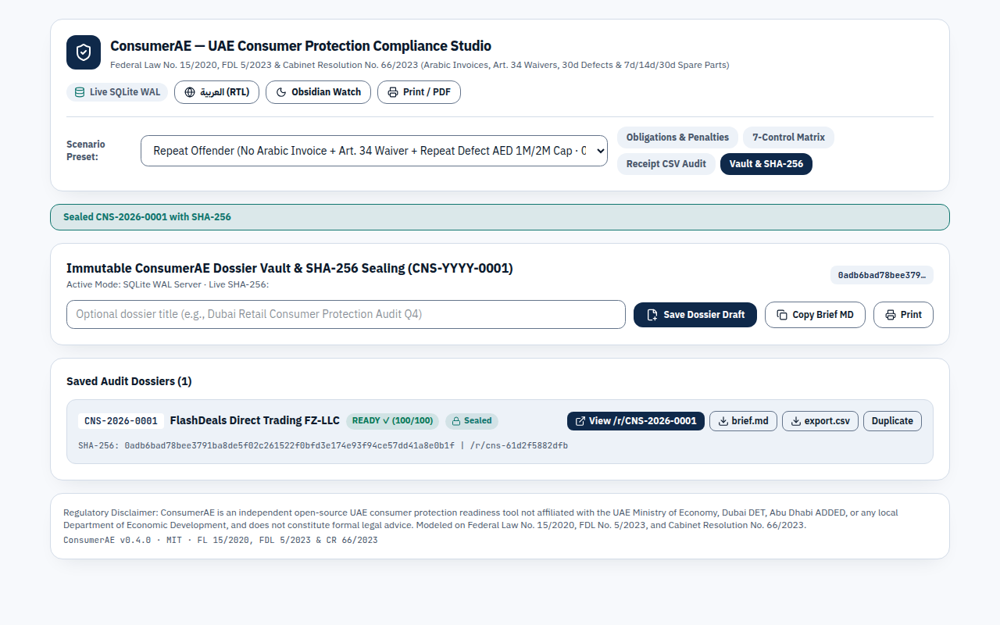
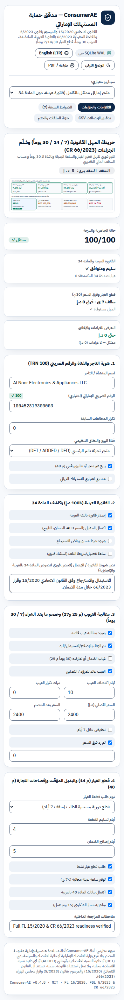
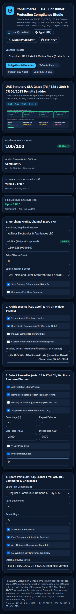

# ConsumerAE — مدقق التزامات حماية المستهلك الإماراتي

**UAE Consumer Protection Law (`Federal Law No. 15 of 2020`, `Federal Decree-Law No. 5 of 2023` & `Cabinet Resolution No. 66 of 2023`) Arabic Invoice, Art. 34 Waiver, 30-Day Defect/Discount & `7d/14d/30d` Spare Parts Readiness Studio**

[](LICENSE)

> **Regulatory Independence Disclaimer:** `ConsumerAE` is an independent open-source compliance modeling and operational audit workbench. It is **not affiliated with, endorsed by, or an official portal of** the UAE Ministry of Economy (`MoE`), Dubai Department of Economy and Tourism (`DET`), Abu Dhabi Department of Economic Development (`ADDED`), or any local DED / Consumer Protection Department, and does not constitute formal legal advice.

---

## Key Capabilities

- **Mandatory Arabic Detailed Invoice Check (`FL 15/2020 Art. 8 & CR 66/2023`)**: Verifies prominent Arabic itemized invoicing (`AED` pricing, merchant trade name, address, quantity, date, and warranty term) against the **`AED 100,000`** administrative penalty threshold.
- **Bilingual Article 34 Prohibited Waiver Scanner (`CR 66/2023 Art. 34`)**: Detects null and void disclaimers across English & Arabic receipts/terms (`"All sales final"`, `"No refund"`, `"No exchange"`, `"Not liable for any defect"`, `"Unilateral termination"`, `«البضاعة المباعة لا ترد ولا تستبدل»`, `«لا استرجاع»`, `«إخلاء مسؤولية»`), accurately separating narrow non-defect custom/perishable exceptions from unlawful defect-liability exclusions.
- **30-Day Defect Remedies & Repeat-Defect Guard (`FL 15/2020 Art. 12`, `CR 66/2023 Arts. 25 & 27`)**: Models the **`30-day`** mandatory refund rule when a warranty is missing, agent-unbacked, or conflicts with spare-parts warranties (`Art. 25`), consumer remedy choice (`repair`, `replacement`, `full refund`), and definitive replacement/refund after **`>= 2`** recurring defect failures (`AED 250,000` administrative exposure).
- **Spare Parts SLAs (`Art. 14`) & Temporary Loaner Substitutes (`Art. 27`)**: Enforces exact **`7-day`** (regular/continuous), **`14-day`** (irregular demand), and **`30-day`** (parallel/external import via local commercial agent) windows plus free temporary substitute tracking whenever warranty repairs exceed **`7 days`**.
- **Post-Purchase Discount Recovery (`7d / 30d`)**: Calculates recoverable price differences in `AED` when undisclosed discounts occur within **`7 days`** of purchase (`30-day` buyer claim window).
- **Art. 40 E-Commerce Disclosures, Scope & `100` TRN Validator**: Tracks Arabic online disclosures for retail, marketplaces, and free-zone B2C sellers (explicitly safeguarding corporate end-users while exempting pure B2B wholesale resale), validates 15-digit `100`-prefixed UAE TRNs, and models `15-working-day` grievance readiness alongside escalating **`AED 1M` admin / `AED 2M` criminal** caps and **`24h–90d`** temporary closure risk.
- **CWE-1236 Safe Batch CSV Auditor + Dual Mode Vault**: Audits batch receipt/complaint CSVs, sanitizes spreadsheet formula-injection leads (`=`, `+`, `-`, `@`), exports `UTF-8 BOM + CRLF` CSVs, seals `CNS-YYYY-0001` dossiers with deterministic `SHA-256` digests, and runs both with `node:sqlite WAL` or `$0` static browser `localStorage`.

---

## Visual Verification (`Playwright Chrome E2E`)

Verified across desktop (`1280x800`) and mobile (`390x844`) viewports in both Arabic RTL (`Alabaster Consumer`) and English LTR (`Obsidian Watch`).

| Arabic RTL Desktop (`Alabaster Consumer`) | English LTR Desktop (`Obsidian Watch`) | Service Agent Spare Parts Conditional (`85/100`) |
|---|---|---|
|  |  |  |

| Sealed Dossier (`CNS-2026-0001`) | Mobile Arabic (`390x844`) | Mobile English Obsidian (`390x844`) |
|---|---|---|
|  |  |  |

---

## Quick Start (`Node >= 22`)

```bash
npm install
npm run typecheck
npm test
npm run build
PORT=4251 BASE_PATH= npm start
```

Open `http://127.0.0.1:4251` (defaults to `AR RTL` **Alabaster Consumer** theme with instant **English LTR** / **Obsidian Watch** switching).

### Playwright Headless Chrome E2E

```bash
npm run build
npm run test:e2e
```

---

## Core HTTP API (`server/app.mjs`)

- `GET /health`, `GET /readyz` — SQLite `WAL` health and readiness probes
- `GET /api/presets` — Canonical `FL 15/2020 & CR 66/2023` presets and 7 controls
- `POST /api/evaluate-obligations`, `POST /api/assess` — Statutory evaluation & `SHA-256` digest scoring
- `POST /api/audit-receipts`, `POST /api/export/receipts-csv` — Batch receipt CSV audit & safe `UTF-8 BOM` export
- `GET/POST /api/profiles`, `GET/PATCH/DELETE /api/profiles/:id` — Merchant profile CRUD
- `GET/POST /api/dossiers`, `GET/PATCH/DELETE /api/dossiers/:code`, `POST /finalize`, `POST /duplicate`, `GET /brief.md`, `GET /export.csv`, `GET /summary`
- `GET /api/public/reports/:slugOrCode` — Immutable sealed dossier view with atomic view counter

---

## `$0` & Self-Hosted Deployment

See [`launch/DEPLOY-AND-SHARE.md`](launch/DEPLOY-AND-SHARE.md) for:
1. **`$0` Static Hosting** on Cloudflare Workers Assets (`wrangler.jsonc`)
2. **Docker / `docker compose`** with persistent SQLite WAL volume
3. **Node 22 + systemd + Caddy + SQLite online backups (`VACUUM INTO`)**
